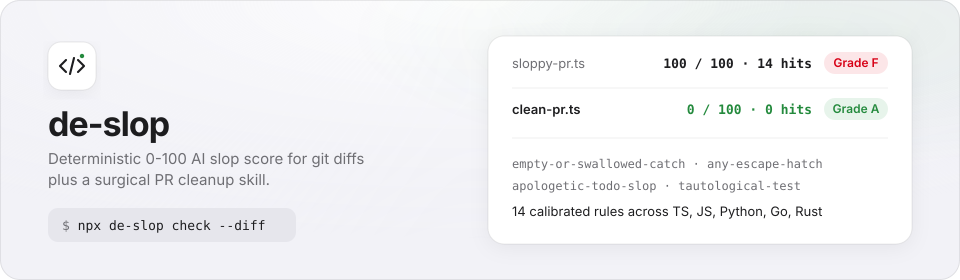

<div align="center">

<p>
  <a href="README.md"><strong>English</strong></a> · <a href="README.ru.md">Русский</a>
</p>



<br/><br/>


**Anti-AI-slop code purifier: deterministic 0-100 slop score for git diffs, CI gate, SVG badge exporter, and cleanup `SKILL.md`.**

Works with Claude Code, Cursor, Windsurf, Codex CLI, and Antigravity.

</div>

Coding agents often leave recognizable clutter in pull requests: empty `catch` blocks, comments that restate `count++`, `any` type escapes, verbose `x !== null && x !== undefined ? x : y` checks, ASCII section banners, leftover `console.log` statements, and tautological assertions like `expect(true).toBe(true)`.

`de-slop` scores a file, folder, or `git diff` deterministically on a `0` to `100` scale with zero npm packages and zero LLM calls, gives an `A` through `F` grade, enforces PR gates via `--max-score`, and ships a portable `SKILL.md` that teaches any agent how to clean the flagged lines before review.

## Quick start

Requires Node.js `>= 22.5.0`.

```bash
# Score only newly added/edited lines in your working git diff
npx -y github:keenfolk1-lgtm/de-slop check --diff

# Enforce a clean PR gate in CI against main and write an SVG badge
npx -y github:keenfolk1-lgtm/de-slop check --base origin/main --max-score 15 --badge ./de-slop.svg

# Reproduce the fixture benchmark
node ./bin/de-slop.mjs benchmark --markdown
```

## Measured benchmark

| Fixture | Slop Score | Grade | Findings |
| --- | ---: | :---: | ---: |
| `fixtures/sloppy-pr.ts` | 100/100 | F | 14 |
| `fixtures/clean-pr.ts` | 0/100 | A | 0 |

## Detection rules (18 calibrated checks)

| Rule ID | Weight | What it flags |
| --- | ---: | --- |
| `empty-or-swallowed-catch` | +14 | Empty `catch {}`, `catch { // ignore }`, or `except: pass` (exempts blocks with substantive explanatory comments). |
| `tautological-test` | +18 | Assertions comparing constants (`expect(true).toBe(true)`). |
| `apologetic-todo-slop` | +15 | Placeholder TODOs ("simplified for brevity", "in a real application"). |
| `python-bare-except` | +12 | Python bare `except:` catching system-exit exceptions. |
| `go-swallowed-error` | +12 | Go `if err != nil { return nil }` or empty error check block. |
| `ts-ignore-without-reason` | +10 | `@ts-ignore` or `@ts-nocheck` without an explanatory reason. |
| `high-comment-ratio` | +10 | Files where comments exceed 45% of non-empty lines. |
| `any-escape-hatch` | +9 | TypeScript `: any`, `as any`, or `<any>`. |
| `async-without-await` | +8 | Short `async function` containing zero `await` keywords. |
| `trivial-passthrough-wrapper` | +8 | Single-line function forwarding arguments unchanged to another function. |
| `ai-prose-in-code` | +8 | Stock phrasing inside code comments (`"here we define..."`). |
| `comment-restates-code` | +7 | Comments sharing >=65% of their tokens with the very next statement (skips pragmas and why-comments). |
| `boolean-ternary-noise` | +7 | `? true : false` or `? false : true`. |
| `redundant-null-fallback` | +7 | Double nullish ternary instead of `??`. |
| `redundant-else-after-return` | +6 | `} else {` right after `return` or `throw`. |
| `console-debug-leftover` | +6 | `console.debug(`, debug `console.log("DEBUG"...)`, `dbg!(`, `print("DEBUG")` outside `bin/`/`scripts/`. |
| `narrating-docstring` | +6 | `@param userId The userId.` repeating the identifier name. |
| `banner-divider-noise` | +5 | `// ================` divider lines. |

Use `--exclude path1,path2` or a `.deslopignore` file to skip generated files, and `de-slop-ignore` comments for intentional exceptions.

## Limitations

`de-slop` uses deterministic line and token heuristics across JS, TS, Python, Go, and Rust, so it will not catch deep semantic duplication across separate modules. In diff mode (`--diff`), only added or modified lines in git hunks are scored, which protects legacy code while focusing checks on new changes.

## License

[MIT](LICENSE)

Related tools: [skill-bench](https://github.com/keenfolk1-lgtm/skill-bench) · [dotagents](https://github.com/keenfolk1-lgtm/dotagents) · [vibe-to-prod](https://github.com/keenfolk1-lgtm/vibe-to-prod) · [blast-radius-mcp](https://github.com/keenfolk1-lgtm/blast-radius-mcp) · [agent-undo](https://github.com/keenfolk1-lgtm/agent-undo)
