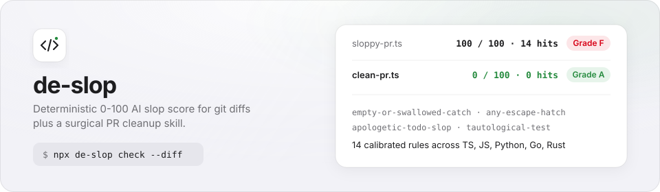

<div align="center">

<p>
  <a href="README.md">English</a> · <a href="README.ru.md"><strong>Русский</strong></a>
</p>



<br/><br/>


**Очистка кода от ИИ-мусора: детерминированный Slop Score (0-100) по `git diff`, CI-гейт, SVG-бейдж и готовый `SKILL.md`.**

Работает с Claude Code, Cursor, Windsurf, Codex CLI и Antigravity.

</div>

Агенты часто оставляют в пул-реквестах характерный шум: пустые `catch {}`, очевидные комментарии вроде `// increment count`, обходы типов через `any`, громоздкие тернарники `? true : false`, длинные баннеры из `======`, забытые `console.log` и пустые тесты `expect(true).toBe(true)`.

`de-slop` проверяет файл, папку или только изменённые строки в `git diff` без npm-зависимостей и запросов к LLM по 18 правилам (JS/TS, Python, Go, Rust), выставляет оценку от `0` до `100` (грейд `A`..`F`), пропускает `catch` с понятным комментарием и поддерживает `--exclude`, `.deslopignore` и `de-slop-ignore`.

## Быстрый старт

Требуется Node.js `>= 22.5.0`.

```bash
# Проверить только добавленные строки в текущем git diff
npx -y github:keenfolk1-lgtm/de-slop check --diff

# Проверка в CI с порогом и генерацией SVG-бейджа
npx -y github:keenfolk1-lgtm/de-slop check --base origin/main --max-score 15 --badge ./de-slop.svg

# Запустить сравнение на тестовых примерах
node ./bin/de-slop.mjs benchmark --markdown
```

## Замеры на примерах

| Файл | Slop Score | Грейд | Срабатывания |
| --- | ---: | :---: | ---: |
| `fixtures/sloppy-pr.ts` | 100/100 | F | 14 |
| `fixtures/clean-pr.ts` | 0/100 | A | 0 |

## Ограничения

`de-slop` опирается на локальные эвристики по строкам и токенам для JS, TS, Python, Go и Rust и не ищет семантическое дублирование между разными модулями. В режиме `--diff` оцениваются только изменённые строки в ханках git, чтобы старый код не мешал проверке новых правок.

## Лицензия

[MIT](LICENSE)

Другие инструменты серии: [skill-bench](https://github.com/keenfolk1-lgtm/skill-bench) · [dotagents](https://github.com/keenfolk1-lgtm/dotagents) · [vibe-to-prod](https://github.com/keenfolk1-lgtm/vibe-to-prod) · [blast-radius-mcp](https://github.com/keenfolk1-lgtm/blast-radius-mcp) · [agent-undo](https://github.com/keenfolk1-lgtm/agent-undo)
